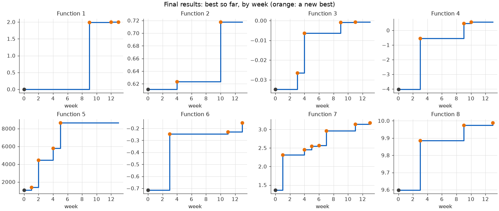

# Imperial AI/ML Capstone: Black-Box Optimisation

## Non-technical explanation
Imagine having to find the best setting of a machine you can't see inside, where each test takes a week and you only get thirteen tries. This project did exactly that for eight hidden "black-box" functions, standing in for problems like tuning an AI model or a chemical recipe. Each week I chose one new input to test per function, using a statistical model that learns from every result so far and estimates where the best values are likely to be, and how unsure it is. Over thirteen weeks, every function improved on its starting data, and one went from no signal at all to a clear peak.

## Project overview
This capstone is a black-box optimization project over eight hidden objective functions. The goal is to decide which new point to query next using only previously observed inputs and outputs, without access to gradients or the true function form. That makes it a good stand-in for real ML problems such as hyperparameter tuning, experiment design, and any setting where evaluations are expensive or limited.

The project is useful and relevant because it teaches how to make good decisions under uncertainty. It combines modeling noisy data, estimating uncertainty, and balancing exploration against exploitation. Those are the same ideas that matter when choosing experiments, tuning models, or prioritizing data collection in a future ML role.

## Challenge objectives
The main objective is to identify the next query point that best improves the hidden objective for each function; in this case, maximisation for all functions. Because the functions are black boxes, the challenge is not just to chase high responses, but to decide when to explore uncertain parts of the space and when to exploit a promising region.

The main constraints are the small number of observations, the lack of derivatives, the varying dimensionality, and the fact that the functions can be smooth, multimodal, spiky, or nearly flat. In some cases the data suggests a clear peak; in others, the safest choice is to keep exploring until the shape of the function becomes clearer.

## Data
The data comes from the course. It has an initial sample for each function, and then the result of each weekly query, returned by the course portal.

Each function takes a normalized input vector in the unit hypercube (i.e. between 0 and 1), with dimensionality ranging from 2D to 8D depending on the function. The output of all functions is a single scalar value. Some functions do not have any output bounds, while others are only negative or positive. The available data starts with an initial sample set and then grows by one weekly query and response per function.

For submission purposes, each query must follow a single hyphen-separated string with each value rounded to six decimal places.

**Sample input:** 0.1859092-0.27476673
**Sample output:** -31.490847736812487

| Function | Inputs | Initial points | Weekly results | Total |
|---|---|---|---|---|
| 1, 2 | 2 | 10 each | 13 each | 23 each |
| 3 | 3 | 15 | 13 | 28 |
| 4 | 4 | 30 | 13 | 43 |
| 5 | 4 | 20 | 13 | 33 |
| 6 | 5 | 20 | 13 | 33 |
| 7 | 6 | 30 | 13 | 43 |
| 8 | 8 | 40 | 13 | 53 |

The course's description of each function is in [function_descriptions.md](function_descriptions.md). The [datasheet](documentation/datasheet.md) describes the data in detail: its structure, noise, gaps and intended uses.

## Model
The final method uses Bayesian optimisation for functions 2 to 8, with a different model for function 1:

- **Surrogate:** a Gaussian process (GP), using BoTorch's default model (Balandat et al., 2020). It fits every observation so far and predicts each point's value with an uncertainty.
- **Acquisition:** the next query is the point with the highest Log Expected Improvement (Ament et al., 2023). This is how much the point is expected to beat the best value so far, so it balances a high prediction against high uncertainty.
- **Trust region:** the search is limited to a box around the best point, as in TuRBO (Eriksson et al., 2019). The box doubles after a week that improved the best value and halves after one that didn't.
- **Function 1:** almost all its readings are about 0, which a GP can't learn from. It uses a radiation-source model instead: least squares fits a bowl to the log of each reading's size, and the query is the bowl's centre.

I chose a GP because there are only 2 to 8 inputs and under 60 observations per function. That's where GPs work best, and their uncertainty estimates are what the acquisition needs. Log Expected Improvement replaced the Upper Confidence Bound I used in weeks 1 to 8, because that needs a hand-set exploration weight, and high weights wasted queries on the edges of the space. The trust region focuses the last few queries where they're most likely to pay off.

- **The method:** the [model card](documentation/model_card.md) describes it in detail, with its performance, limitations and trade-offs.
- **How it changed:** the [technical approach](documentation/technical_approach.md) traces it week by week, including the queries I set by hand in weeks 11 to 13.
- **Walkthrough:** the notebook [method_and_results.ipynb](implementation/method_and_results.ipynb) runs through the method and its results.

## Hyperparameter optimisation
There are two kinds of hyperparameter:

- **The GP's own:** a length scale for each input (how quickly the function changes along it), the output scale and the noise level. They're fitted automatically every week, by maximising the marginal likelihood of the data, with BoTorch's default priors on the length scales and the noise (Hvarfner et al., 2024). In weeks 4 to 8 I set bounds on the length scales by hand, but the fitted values kept hitting those bounds, so the bounds rather than the data were deciding them.
- **The method's settings:** the acquisition function, the trust region's starting size and update rule, the kernel, and each function's output scale and noise setting. I chose them in week 9 by testing on the data so far:
  - how well each model ranked observations it hadn't seen (leave-one-out);
  - how much its query moved when one observation was left out;
  - simulated final rounds on test functions with known maxima.

  In week 10, RBF and Matérn kernels gave very similar results, so I kept the simpler RBF. Before week 9, I tuned the exploration weight (kappa) and the length-scale bounds by hand for each function, every week.

In hindsight, the noise setting mattered more than any other choice. Function 4's noise-free setting came from a single surprising result, and it made the model overconfident.

## Results


Week 0 is the best of the initial data, and orange marks a new best.

| Function | Best initial | Final best | Found in week |
|---|---|---|---|
| 1 | 7.7e-16 | 1.99938 | 13 |
| 2 | 0.611 | 0.718 | 10 |
| 3 | −0.0348 | −0.00070 | 11 |
| 4 | −4.03 | 0.571 | 10 |
| 5 | 1,089 | 8,662 | 5 |
| 6 | −0.714 | −0.153 | 13 |
| 7 | 1.365 | 3.182 | 13 |
| 8 | 9.598 | 9.989 | 13 |

- **Every function beat its initial data,** and the final method (from week 9) improved seven of the eight. Function 5 was already at its maximum, the (1, 1, 1, 1) corner.
- **Function 1** went from no signal at all to a clear peak, once the model treated it as a radiation source.
- **Function 7** is the Hartmann-6 benchmark, which I treated as a black box. Its final value is 96% of the benchmark's known maximum.
- **Knowing how much to trust each result mattered most.** The GP's uncertainty was too narrow: only about a quarter of results fell inside its 68% range. Some functions turned out to be noise-free, and others noisy.
- **Hand-set queries in the final weeks worked when they stayed close to points already measured:** four of the seven that aimed to beat the best value did.

## Repository structure
* `implementation/` has each week's script (`week1.py` to `week13.py`), the graphs they save in `figures/`, and the notebook [method_and_results.ipynb](implementation/method_and_results.ipynb). `figures/final_progress.png` is the final progress graph.
* `documentation/` has the [datasheet](documentation/datasheet.md), the [model card](documentation/model_card.md) and the week-by-week [technical approach](documentation/technical_approach.md).
* `assignments/` has each week's answers to the course questions (`week1.md` to `week13.md`) and `final_repository.md`. It also has `week9_report.md` on the week 9 approach and `week12_presentation.pdf`, the project presentation.
* `initial_data/` and `weekly_data/` hold the starting data and each week's queries and results.
* `function_descriptions.md` has the course's description of each function.

## How to run
One uv environment at the root covers every week and the notebook:

```
uv sync
cd implementation
uv run python week13.py               # propose the next round's queries, no graphs
uv run python week13.py --plots save  # also save the graphs to figures/weekN/
```

`week13.py` proposes the round after the latest results in `weekly_data/`. To see the method and results, open `implementation/method_and_results.ipynb` with the repository's `.venv` as the kernel (for example in VS Code). You can also rerun it from the root with `uv run jupyter nbconvert --to notebook --execute --inplace implementation/method_and_results.ipynb`.