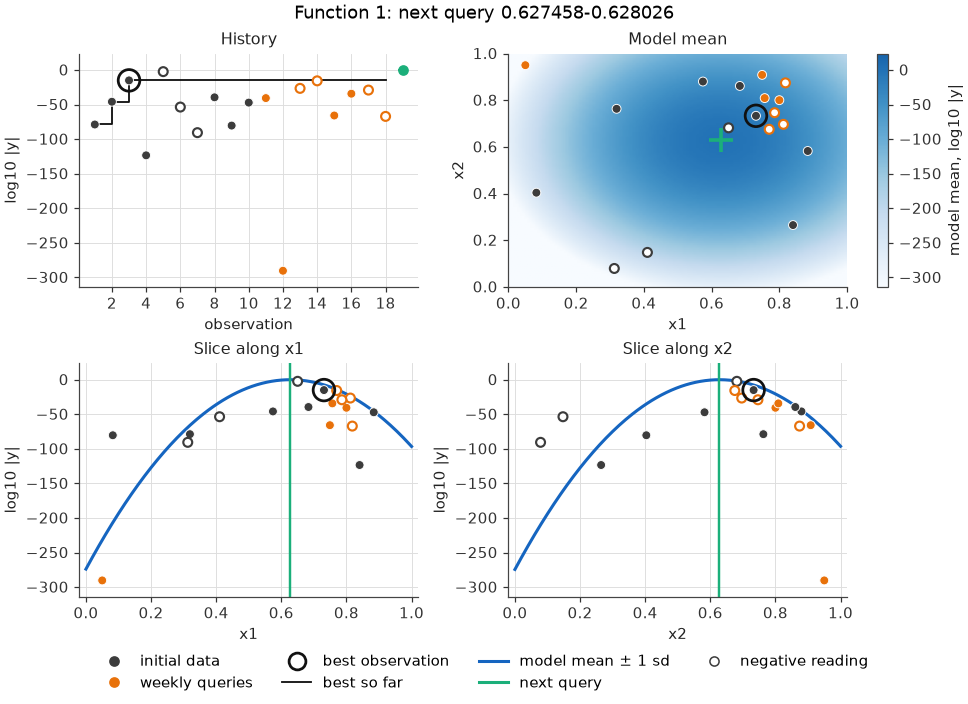
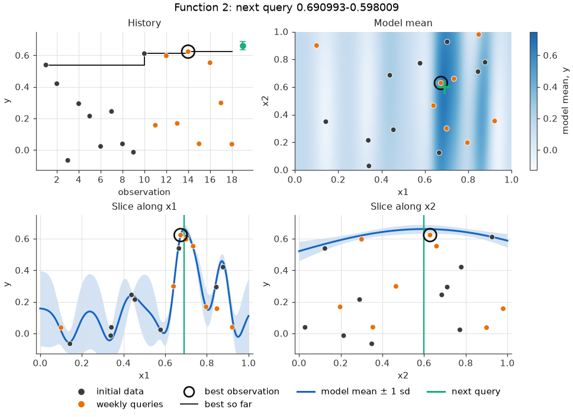
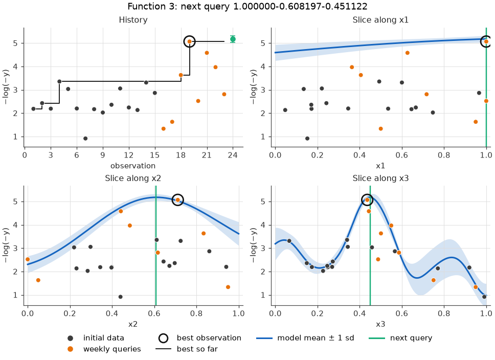
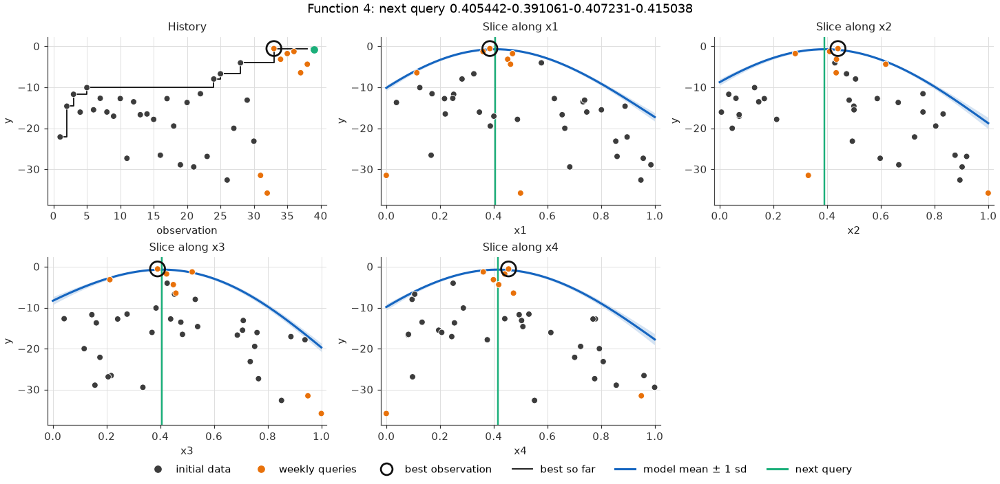
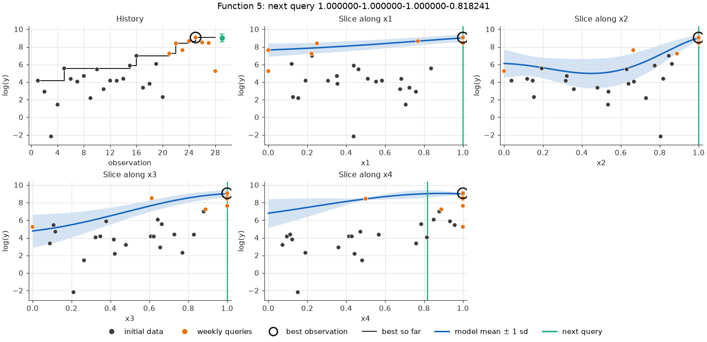
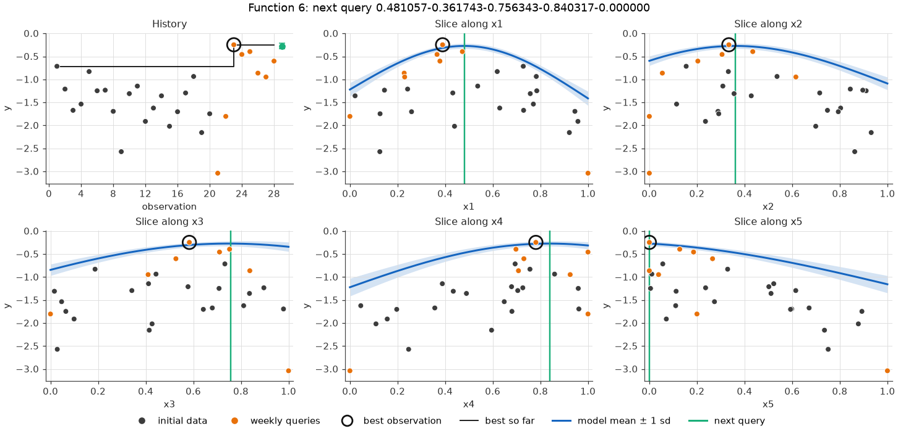
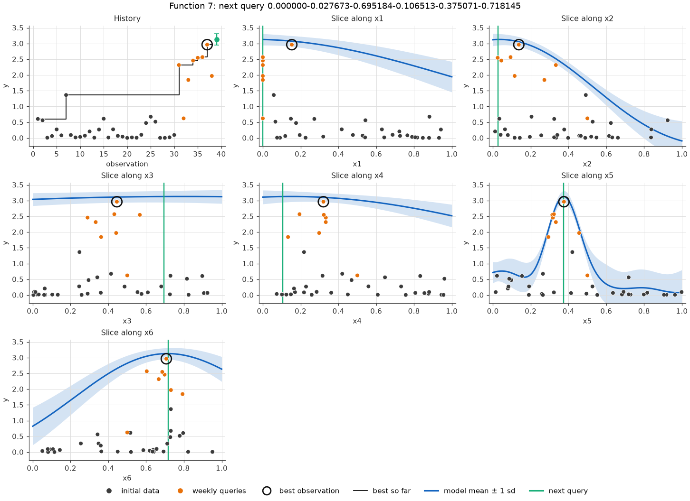
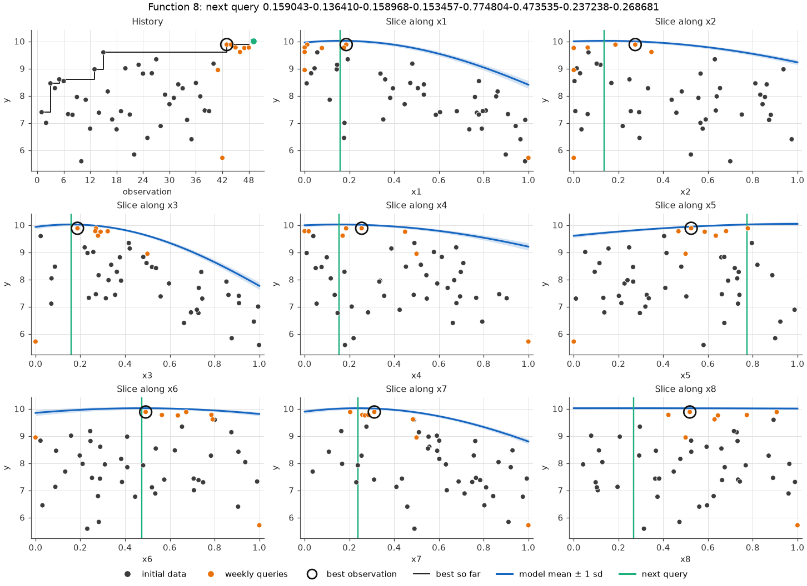

# Week 9

This week replaces the approach used since week 4 (a BoTorch Gaussian process with hand-set kernel bounds and UCB, set up the same way for every function) with a method chosen for each function from its description in the brief ([function_descriptions.md](../function_descriptions.md)) and from tests on the data collected so far.

[week9.py](../implementation/week9.py) produces the queries and, optionally, the graphs.

## This week's queries

| Function | Method | Query | Model's prediction (68% range) | Best so far |
|---|---|---|---|---|
| 1 | Radiation-source model | 0.627458-0.628026 | \|y\| ≈ 0.76 | 7.7e-16 |
| 2 | GP + LogEI | 0.690993-0.598009 | 0.662 (0.634 to 0.690) | 0.624 |
| 3 | GP on −log(−y) + LogEI | 1.000000-0.608197-0.451122 | −0.0056 (−0.0065 to −0.0049) | −0.0063 |
| 4 | GP + LogEI | 0.405442-0.391061-0.407231-0.415038 | −0.70 (−0.91 to −0.50) | −0.54 |
| 5 | GP on log(y) + LogEI | 1.000000-1.000000-1.000000-0.818241 | 8,287 (5,412 to 12,690) | 8,662 |
| 6 | GP + LogEI | 0.481057-0.361743-0.756343-0.840317-0.000000 | −0.272 (−0.328 to −0.216) | −0.246 |
| 7 | GP + LogEI | 0.000000-0.027673-0.695184-0.106513-0.375071-0.718145 | 3.13 (2.95 to 3.31) | 2.964 |
| 8 | GP + LogEI | 0.159043-0.136410-0.158968-0.153457-0.774804-0.473535-0.237238-0.268681 | 10.02 (9.98 to 10.07) | 9.885 |

The GP functions are searched within ±0.25 of their best point so far (see below).

## What changed, and why

### Function 7 is the Hartmann-6 benchmark, but I treat it as a black box

The brief calls function 7 "a commonly used model" and suggests researching the literature. Comparing every function against the standard test functions in BoTorch showed that function 7 is exactly Hartmann-6, a common 6D benchmark in Bayesian optimisation: all 38 observations match it to machine precision (the largest difference is 4e-16). Its global maximum, and where it occurs, are published.

I'm choosing not to use that. Querying a known answer would defeat the purpose of the project, which is to optimise functions as black boxes, so function 7 uses the same GP method as the others. (`week9.py` can still query the known maximum, if function 7's method is set to `"hartmann6"` in `SETTINGS`.)

No other function matches a standard benchmark.

### Function 1: a radiation-source model instead of a GP

Almost every reading of function 1 is effectively zero: they range from 1e-291 to 7.7e-16, plus one reading of −3.6e-3. On that scale a GP can't tell 1e-16 from 1e-291, and in leave-one-out tests it ranked unseen readings worse than chance. But the brief says only proximity to a source gives a non-zero reading, and the *size* of the readings does fall off smoothly with distance. If a source's reading falls off like a Gaussian, its logarithm is a quadratic bowl around the source:

```
|y| = A · exp(−‖x − c‖² / 2s²)    ⇒    log10|y| = a − k · ‖x − c‖²
```

Expanding the square makes this linear in [1, x1, x2, x1² + x2²], so it can be fitted by ordinary least squares.

- **The fit:** using the 13 readings within 0.4 of the strongest one, it is typically within 0.6 orders of magnitude of the readings, which span 65.
- **The source:** a narrow one (width about 0.018) at (0.627, 0.628), with a predicted peak reading of about 0.76.
- **Stability:** the centre moves by less than 0.002 when any reading is left out, or when the cut-off radius changes anywhere between 0.3 and 0.5.
- **Shape:** an exponential fall-off (a − k·‖x − c‖) fits far worse, with a leave-one-out error of 7.2 orders of magnitude against 0.8 for the Gaussian.
- **Sign:** ignored. 5 of the 13 readings near the source are negative, with no pattern by direction or distance, so only their size says how close they were.
- **A second source:** the five far-away readings are too strong for this source. Fitting two sources to all 18 readings puts a weaker one (peak about 0.009) at about (0.42, 0.42), which fits the brief's "strong and weak sources".

Precision matters because the source is narrow. A GP fitted to log10|y| would have queried 0.21 away from the centre, where the source model predicts a reading 31 orders of magnitude weaker.

### The other functions: Bayesian optimisation with better defaults

Functions 2 to 8 use one method:

- **Model: BoTorch's default GP.** It uses an RBF kernel with one length scale per input, with priors on the length scales (scaled to the number of inputs; Hvarfner et al., 2024) and on the noise level. These replace the hand-set length-scale bounds of previous weeks. With those settings, 30 of the 34 fitted length scales sat on a bound, so the bounds rather than the data were shaping the models.
- **Acquisition: Log Expected Improvement (LogEI).**
  - Expected improvement is how much a point is expected to beat the best value so far. It trades off a high predicted mean against high uncertainty, with no κ to tune.
  - LogEI computes it on a log scale, which stays numerically stable when EI is tiny (Ament et al., 2023).
  - "Best so far" is the GP's highest mean at the observed points rather than the raw maximum, so one lucky noisy reading doesn't set the bar (the brief describes function 2 as noisy).
- **Search within ±0.25 of the best point so far.** This is a trust region, as in TuRBO (Eriksson et al., 2019).
  - With only a few rounds left, improving the best region is worth more than exploring far away, where the GP extrapolates least reliably.
  - It matches the brief for function 5 (one peak) and function 8 (settle for a strong local maximum).
- **A more reliable acquisition optimiser.**
  - BoTorch's `optimize_acqf` returned far corners for functions 2 and 4, even though points next to the best had far higher expected improvement. For function 4, the corner's log-EI was −28.9, against −1.3 next to the best.
  - The cause: when L-BFGS-B warns, `optimize_acqf` retries from new random starting points and discards the first attempt, even if it was better.
  - The script now picks its own starting points: 20,000 random points plus small perturbations of the five best observations. It runs L-BFGS-B from the best 32, and gives the same query whatever the random seed.

Two functions are modelled on a transformed scale:

- **Function 3, on −log(−y).**
  - Its output is the negative of side effects, so it can't exceed 0, and the best so far is already −0.0063.
  - Fitted to y directly, the GP predicted impossible positive values (+0.014). Its query was also fragile: leaving out one observation moved it by 0.1 on average.
  - On the −log(−y) scale every prediction maps back below 0, and the query sits next to the best point and is far more stable.
  - This scale ranks all observations slightly less well in leave-one-out tests (0.66 against 0.76), but what matters now is the region next to the ceiling.
- **Function 5, on log(y).**
  - Yield is positive and spans 0.1 to 8,662. On a log scale the GP ranks unseen observations better (0.86 against 0.74).
  - The best point is the corner (1, 1, 1, 1). This week's query tests whether the single peak sits just inside the x4 edge.
  - If it scores lower, function 5 has very likely reached its maximum at the corner.

## Evidence

These checks were run on the data through week 8, while choosing the method.

### Prediction quality

The table shows leave-one-out rank correlation. Each observation is predicted from all the others, and the predictions are rank-correlated with the actual values (1 = a perfect ranking). "Previous" is the Matérn kernel with hand-set bounds used since week 4, with the bounds drafted for this week.

| Function | Previous | This week | Scale |
|---|---|---|---|
| 1 | −0.38 | 0.91 | log10\|y\|, with a GP (the query itself uses the source model) |
| 2 | 0.80 | 0.78 | y |
| 3 | 0.56 | 0.66 | −log(−y) (0.76 on y) |
| 4 | 0.97 | 0.99 | y |
| 5 | 0.75 | 0.86 | log(y) |
| 6 | 0.93 | 0.96 | y |
| 8 | 0.93 | 1.00 | y |

### Stability

How far each query moves when one observation is left out, re-running the whole method each time:

| Function | Median move | Moves under 0.05 |
|---|---|---|
| 2 | 0.008 | 61% |
| 3 | 0.027 | 61% |
| 3, fitted to y | 0.105 | 9% |
| 4 | 0.002 | 100% |
| 5 | 0.003 | 96% |
| 6 | 0.030 | 75% |
| 8 | 0.016 | 73% |

### Simulated final rounds

The real functions can't be queried in advance, so the acquisition choice was tested on stand-ins with known maxima:
- Hartmann-3, -4 and -6;
- sums of Gaussian bumps in 2D (with noise), 5D and 8D;
- a single 4D peak at or just beyond the corner.

Each stand-in was run from 20 random starts, with the same model and optimiser as `week9.py`. The starting data has the brief's number of initial points plus 8 weekly-style queries (UCB, κ = 3), so it clusters around good regions, like ours. The table shows the share of the gap to the maximum closed in three more rounds.

| Stand-in (for) | LogEI | LogEI + box | UCB κ=1 | UCB κ=2 | UCB κ=3 | UCB κ=5 |
|---|---|---|---|---|---|---|
| bumps 2D, noisy (f2) | 0.51 | 0.49 | 0.45 | 0.63 | 0.34 | 0.04 |
| Hartmann-3 (f3) | 0.66 | 0.70 | 0.66 | 0.60 | 0.60 | 0.61 |
| Hartmann-4 (f4) | 0.31 | 0.31 | 0.31 | 0.32 | 0.29 | 0.26 |
| single peak 4D (f5) | 0.56 | 0.56 | 0.56 | 0.59 | 0.42 | 0.03 |
| bumps 5D (f6) | 0.38 | 0.42 | 0.38 | 0.24 | 0.24 | 0.03 |
| Hartmann-6 (f7) | 0.05 | 0.10 | 0.10 | 0.08 | 0.25 | 0.23 |
| bumps 8D (f8) | 0.27 | 0.27 | 0.26 | 0.21 | 0.10 | 0.01 |
| **mean** | 0.39 | **0.41** | 0.39 | 0.38 | 0.32 | 0.17 |

- **The box:** LogEI with the ±0.25 box had the best average and was never clearly worse than searching everywhere.
- **UCB:** with κ = 1–2 it did about as well as LogEI. Larger κ did worse: κ = 5, used for several functions in earlier weeks, closed less than half as much of the gap.
- **From uniformly random starting data instead:** the box helped more (+0.07 ± 0.02 of the gap), and the exploratory UCB settings caught up, because the global peak is often still undiscovered in that setting.

## Graphs

With `--plots show` or `--plots save`, `week9.py` draws one figure per function, on the scale the model works on:

- **History:** every observation in order, the best so far, and the model's prediction for the next query.
- **Best observation:** marked with a black ring in every panel. The next query is in green.
- **Negative readings (function 1 only):** drawn hollow, because its graphs show the size of each reading, which hides the sign.
- **Model mean (2D functions only):** a map of the model's mean over the whole input space.
- **Slices:** one per input, through the next query, varying that input alone. Each shows the model's mean ± 1 standard deviation. The dots are all the observations projected onto that input, so they don't lie on the slice.

**Function 1.** The source model's bowl. Readings fall off by hundreds of orders of magnitude away from the centre (the green cross).


**Function 2.** The GP finds a narrow ridge at x1 ≈ 0.7 that is nearly flat along x2. The query sits on the ridge, next to the best point.


**Function 3.** On the −log(−y) scale (higher is better), the good results line up at x3 ≈ 0.45, and x1 matters little.


**Function 4.** A smooth bowl around (0.4, 0.4, 0.4, 0.4). The query is next to the best point.


**Function 5.** Yield rises towards the corner (1, 1, 1, 1) along every input. The query tests x4 just inside the edge.


**Function 6.** A broad maximum. The query sits near the top of every slice, with x5 at 0.


**Function 7.** Treated as a black box. The GP finds a sharp peak in x5 at about 0.37. The query keeps x5 there and moves the other inputs within the search box.


**Function 8.** Long length scales mean a smooth surface, and x8 barely matters. The query raises x5 to the edge of the search box, where the GP predicts the biggest gain.


## Running the code

```bash
cd implementation
uv run python week9.py                 # all functions, no graphs
uv run python week9.py 3               # function 3 only
uv run python week9.py --plots show    # show the graphs in windows
uv run python week9.py --plots save    # save the graphs to figures/week9/
```

The script uses every weekly result in `weekly_data/` up to the previous week, and warns if one is missing.

## Risks, and what to watch next week

The plan assumes that only the best value found counts, so a query that scores badly costs nothing.

- **Function 1:** the strongest reading so far was negative. If the reading at the source's centre comes back large and negative, the source itself reads negative, and the next target is the weaker source near (0.42, 0.42).
- **Function 3:** at most 0.0063 is left to gain, if the ceiling is 0.
- **Function 5:** probably already at its maximum at the corner. If this week's query scores lower, the next one could test x2 near the corner, the one input not yet varied there.
- **Function 7:** treated as a black box by choice, even though it is Hartmann-6.
- **Remaining rounds:** the method leans towards exploitation, which suits a few remaining rounds. With many rounds left, more exploration (a wider box, or UCB with κ = 2) would be worth considering.

## References

- Ament, S., Daulton, S., Eriksson, D., Balandat, M. & Bakshy, E. (2023). *Unexpected improvements to expected improvement for Bayesian optimization.* NeurIPS.
- Balandat, M. et al. (2020). *BoTorch: a framework for efficient Monte-Carlo Bayesian optimization.* NeurIPS.
- Dixon, L. C. W. & Szegő, G. P. (1978). *Towards Global Optimisation 2.* North-Holland. (The Hartmann functions; their definitions and optima are listed in the Virtual Library of Simulation Experiments, Surjanovic & Bingham.)
- Eriksson, D., Pearce, M., Gardner, J., Turner, R. & Poloczek, M. (2019). *Scalable global optimization via local Bayesian optimization.* NeurIPS.
- Hvarfner, C., Hellsten, E. O. & Nardi, L. (2024). *Vanilla Bayesian optimization performs great in high dimensions.* ICML.
- Srinivas, N., Krause, A., Kakade, S. & Seeger, M. (2010). *Gaussian process optimization in the bandit setting: no regret and experimental design.* ICML.
