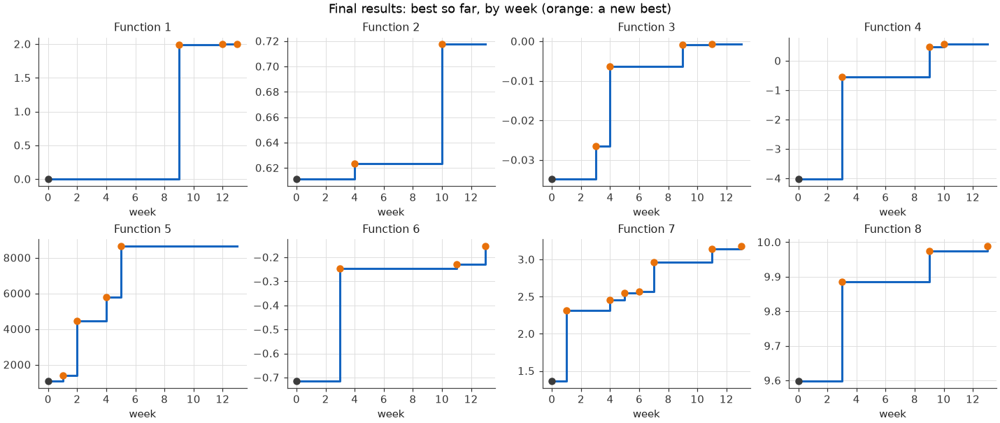

# Model card: per-function Bayesian optimisation with a trust region

- **Type:** a sequential, model-based black-box optimiser. A Gaussian-process (GP) surrogate with an acquisition function proposes each query, and a least-squares physical model does so for function 1.
- **Version:** final (week 13), in [implementation/week13.py](../implementation/week13.py), with a walkthrough in [implementation/method_and_results.ipynb](../implementation/method_and_results.ipynb). Every earlier week's version is kept in `implementation/`.
- **Related documents:** the [datasheet](datasheet.md) for the data, and the [technical approach](technical_approach.md) for how the method changed each week.

## Model description

**Input:** for each function, every observation so far: inputs in the unit hypercube [0, 1]^d, with d from 2 to 8, and their outputs. The settings table in the code adds a method, an output transform and a noise setting per function. The trust region's size is recomputed from the history of results.

**Output:** one query per function per round, a point in [0, 1]^d written as six decimals joined by hyphens. For each query the script also reports the model's prediction with a 68% range, and it can save graphs of the model and of the progress so far.

**Model architecture:**

1. **Surrogate:** BoTorch's default GP (`SingleTaskGP`). It has an RBF kernel with one length scale per input, priors on the length scales that scale with the number of inputs, a learned noise level, and standardised outputs. Its hyperparameters are fitted by maximising the marginal likelihood.
   - Function 3 is modelled on −log(−y), since it can't exceed 0, and function 5 on log(y), since it spans 0.1 to 8,662.
   - Function 4's noise is fixed near zero, so its GP passes through every observation.
2. **Acquisition:** Log Expected Improvement (LogEI), the numerically stable form of expected improvement. "Best so far" is the GP's highest mean at the observed points, so one lucky noisy reading doesn't set the bar; for function 4 it's the best observed value.
3. **Trust region (TuRBO-style):** only a box around the best point is searched. Its side started at 0.5 in week 9, doubles after a week that improved the best value, halves after one that didn't, and stays between 0.5^7 and 1.6. It's longer along inputs the GP finds less important.
4. **Search:** the acquisition is maximised from the best 32 of 20,000 random points and 2,000 small nudges of the five best observations, each refined by L-BFGS-B. Fixed seeds make every query reproducible.
5. **Function 1:** readings fall off with distance from a radiation source, so log10|y| is fitted as a quadratic bowl by least squares, on the readings within 0.4 of the strongest one. The query is the bowl's centre.
6. **Function 7** matches the Hartmann-6 benchmark, but it's deliberately treated as a black box, because using the known answer would defeat the purpose of the project.

How the approach evolved over the 13 rounds:

| Rounds | Surrogate | Acquisition | Search |
|---|---|---|---|
| 1–2 | scikit-learn GP, RBF kernel, hand-set length scale | UCB, kappa per function | grid search, plus manual choices from plots |
| 3 | GP with one length scale per input, normalised outputs | UCB | multi-start L-BFGS-B |
| 4–8 | BoTorch GP, Matérn kernel, hand-set length-scale bounds | UCB, kappa up to 5 | BoTorch's `optimize_acqf` |
| 9 | BoTorch's default GP (priors instead of bounds); a source model for function 1 | LogEI | ±0.25 box around the best point |
| 10–13 | as week 9; function 4 noise-free | LogEI | adaptive trust region; some queries set by hand in weeks 11–13 |

## Intended use

- **Suitable for:** maximising expensive black-box functions with few inputs (2–8), scaled to [0, 1], with a budget of tens of evaluations, one at a time. Examples are tuning a few hyperparameters or experimental settings, where each query has to count.
- **Avoid:**
  - *Many inputs or many observations.* Above about 10 inputs the exact GP gets slow, and the trust region settings weren't tested there.
  - *Discrete or categorical inputs.*
  - *Settings where a bad query has a real cost.* The strategy takes risky queries when the downside is zero, as it is in this capstone.
  - *Other functions as they are.* Function 1's source model and the per-function settings are tailored to this data.

## Performance

**How it's measured:** the main metric is the best value found for each function, compared with the best of the initial data, since that's what the capstone scores. It's measured on all 279 observations: the course's initial data plus 13 weekly queries per function. The supporting checks below were run on the same data while the method was being chosen.

| Function | Best initial | Best after week 8 (old method) | Final best (week) |
|---|---|---|---|
| 1 | 7.7e-16 | 7.7e-16 | 1.99938 (13) |
| 2 | 0.611 | 0.624 | 0.718 (10) |
| 3 | −0.0348 | −0.0063 | −0.00070 (11) |
| 4 | −4.03 | −0.540 | 0.571 (10) |
| 5 | 1,089 | 8,662 | 8,662 (5) |
| 6 | −0.714 | −0.247 | −0.153 (13) |
| 7 | 1.365 | 2.964 | 3.182 (13) |
| 8 | 9.598 | 9.885 | 9.989 (13) |

- **Improvement:** all eight functions beat their initial data. The final method improved seven of them after week 8. Function 5 didn't need it: its maximum, the (1, 1, 1, 1) corner, was found in week 5 and confirmed by testing every direction around it.
- **Gap to the maximum:** function 7 is the only one with a known maximum (3.32237). The gap shrank from 0.36 after week 8 to 0.14, so the final value is 96% of the maximum.
- **Surrogate quality:**
  - *Ranking:* in week 9's tests, the GP's leave-one-out rank correlation was between 0.78 and 1.00 for functions 2, 4, 5, 6 and 8, but only 0.66 for function 3 and 0.65 for function 7.
  - *Kernels:* RBF, Matérn 5/2 and Matérn 3/2 kernels ranked held-out points about equally well, and swapping them moved the queries by at most 0.18. RBF was kept.
- **Calibration:** the GP's uncertainty was too narrow. In weeks 9–13, only about a quarter of results fell inside its 68% range, against the two thirds expected.
- **Simulations:** on test functions with known maxima, LogEI with the box closed 41% of the gap to the maximum over three final rounds, against 17% for the UCB kappa of 5 used in earlier weeks.
- **Hand-set queries:** of the seven in weeks 12–13 that aimed to beat the best value, four did (functions 1 twice, 6 and 7).

## Limitations

**Assumptions**
- **Smoothness:** the GP assumes each function is equally smooth everywhere, with one length scale per input.
- **Function 1:** the sign of a reading is noise, and its size depends only on the distance to a single source.
- **Ranges from the brief:** function 3 stays below 0, and function 5 stays above 0.
- **Scoring:** only the best value counts, so a risky query costs nothing.

**Limitations and failure modes**
- **Few points:** every decision rests on 23 to 53 observations per function.
- **Overconfidence:** the 68% ranges held only a quarter of the results, so the model's predictions shouldn't be taken at face value. Function 4's noise-free GP predicted 0.60, 0.97 and 0.71 for results of −0.15, 0.43 and 0.43.
- **Noise assumptions:** each function's noise setting mattered more than any other choice, and getting it right takes data.
  - *Function 4:* with learned noise, the GP flattened the peak to −0.26, below two observed values; noise-free, it overshot.
  - *Function 3:* the GP treats its sharp ridge in x3 as noise.
  - *Function 5:* it turned out to be fully deterministic.
- **Peak precision for function 1:** the source model is fitted mostly to faint readings, so it can't place the peak finely. Near the peak its query drifted the wrong way, and hand-set fits to the strongest readings did better.
- **Local maxima:** the trust region favours the best region found so far, so it can miss a better peak elsewhere. Function 2's brief warns about this.
- **Reacting to one result:** the box resizes after a single week, so one noisy reading can shrink it.
- **Hand-set queries:** eight queries in weeks 11–13 were set by hand. They're recorded in the [technical approach](technical_approach.md), but the code alone doesn't reproduce them.
- **Hard stops:** the script stops with an error if function 1's source model loses its peak, or if function 3 returns exactly 0.

## Trade-offs

- **Exploitation over exploration:** the trust region and LogEI concentrate queries near the best point. That's efficient with few rounds left, but less suited to functions with several peaks.
- **One kernel for every function:** a single smooth kernel keeps the code simple, and the alternatives tested didn't do better. But it can't describe a sharp ridge (function 3) and a flat region (function 8) equally well.
- **Learned noise or noise-free:** learned noise is robust to a lucky reading but blurs a sharp peak; noise-free follows every reading but extrapolates steep trends. Function 4 showed both failures.
- **Tailoring:** output transforms and function 1's source model fit these functions well, but they don't transfer to new ones.
- **Judgement or reproducibility:** hand-set queries improved four functions but broke the rule that the same data always gives the same query, so each one is documented.
- **Performance issues:** results were weakest where the GP's assumptions held least:
  - *Function 2:* a noisy, narrow ridge, whose best value was probably a lucky reading;
  - *Function 3:* a sharp ridge;
  - *Function 4:* a sharp peak, possibly with some noise.
- **Compute:** an exact GP is fast for fewer than 60 points, but its cost grows with the cube of the number of points.

## Ethical considerations

- **Reproducibility:** every automated choice is in one script, with a per-function settings table, comments, fixed seeds and a pinned environment. With the data in this repository, anyone can regenerate each automated query exactly, and the hand-set ones are listed with their reasons.
- **Real-world adaptation:** the assumptions are written down so they can be checked before the approach is reused. In real settings a bad query rarely costs nothing: it can mean a failed experiment, a harmful compound or a wasted batch. The risk-taking parts would need to change.
- **Honesty about shortcuts:** function 7 matches a published benchmark. Using its known maximum would have scored well but said nothing about the method, so it's treated as a black box, and this card says so.
